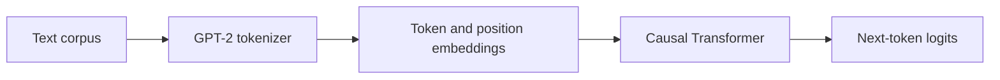

# Mini-GPT

**A GPT-style language model built in PyTorch to study next-token prediction.**

This project implements the model pipeline from GPT-2 tokenization and learned embeddings through masked multi-head attention, Transformer blocks, and greedy decoding. It follows concepts and examples from Sebastian Raschka’s *Build a Large Language Model (From Scratch)*.



| Model configuration | Value |
| --- | --- |
| Context window | 256 tokens |
| Transformer layers | 12 |
| Attention heads | 12 |
| Embedding width | 768 |

## Run locally

From the repository root, create and activate a Python virtual environment and install the dependencies.

```bash
python -m venv .venv
# Windows PowerShell: .venv\Scripts\Activate.ps1
# macOS / Linux: source .venv/bin/activate
python -m pip install -r requirements.txt
```

Place a UTF-8 corpus you have permission to use at `data.jsonl`. Each line should be a JSON object with a `text` field. Use enough text for both training and validation to produce complete token windows.

```json
{"text":"A story or document from your training corpus."}
```

```bash
python train.py
```

The trainer reads the corpus, computes next-token cross-entropy, tracks training and validation loss, and writes latest, best, and per-epoch checkpoints. For generation, copy a compatible checkpoint you produced to `gpt_checkpoint.pt` in the repository root, then run:

```bash
python generate.py
```

The prompt is set in `generate.py`. If the checkpoint is absent, the script uses random weights. GPT-2 tokenization may need network access on first use.

## Repository guide

| Path | Role |
| --- | --- |
| `model/` | Embeddings, causal attention, Transformer blocks, and the GPT model |
| `config.py` | Model dimensions and context length |
| `tokenizer.py` | GPT-2 tokenizer and dataset loaders |
| `train.py` | Training, validation, checkpointing, and loss plotting |
| `generate.py` | Checkpoint loading and greedy generation |
| `data/scraper.py` | Converts local text into story records using heuristic boundaries |
| `prepare_data.py` | Optional pre-tokenization utility for separate train and validation JSONL files |

**Status:** Training is in progress. The public release includes the implementation and instructions for using your own corpus and checkpoint.
